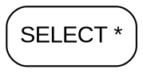

# Mini SQL Query Parser — Complete Project Details

## 1. Project Overview

**Mini SQL Query Parser** is a Compiler Construction mini project written in
Python. It is an educational tool that reads a limited subset of SQL, performs
lexical analysis and syntax analysis, creates an Abstract Syntax Tree (AST),
and presents the result in text and Graphviz DOT form.

The project **does not execute SQL**, create database connections, access data,
or modify any database. Its only purpose is to demonstrate the front-end stages
of a compiler.

### Main Objectives

- Convert SQL source code into location-aware tokens.
- Check whether the token sequence follows a defined LL(1) grammar.
- Build a typed AST for valid SQL statements.
- Show clear lexical and syntax errors for invalid input.
- Provide a Streamlit web interface and a command-line interface.
- Keep the implementation simple enough to explain in a viva.

## 2. Technology Stack

| Area | Technology |
| --- | --- |
| Language | Python 3.10+ |
| Web interface | Streamlit |
| AST graph | Graphviz DOT through `st.graphviz_chart` |
| Testing | pytest |
| Tokenizer | Hand-written character-by-character scanner |
| Syntax analyzer | Hand-written recursive-descent analyzer |

No SQL execution library or parsing library is used. In particular, the project
does not use `sqlparse`, `sqlglot`, PLY, Lark, ANTLR, or any parser generator.
Python's `re` module is used only for matching one identifier or number token at
the current scanner position.

## 3. Current Project Structure

```text
mini-sql-query-parser/
├── app.py                         Streamlit user interface
├── main.py                        Command-line user interface
├── requirements.txt               Runtime and test dependencies
├── README.md                      Quick-start guide and limitations
├── PROJECT_DETAILS.md             This complete project report
├── lexer/
│   ├── token_types.py             TokenType enum and Token data class
│   └── tokenizer.py               Hand-written SQL tokenizer
├── sql_parser/
│   ├── ast_nodes.py               Typed AST node classes
│   └── sql_parser.py              Recursive-descent SQLParser
├── visualizer/
│   └── tree_visualizer.py         AST to text tree and Graphviz DOT
├── utils/
│   ├── error_handler.py           LexicalError and SQLSyntaxError
│   └── analysis.py                Shared analysis workflow
├── tests/
│   ├── test_lexer.py              Tokenizer tests
│   ├── test_parser.py             Grammar and AST tests
│   ├── test_visualizer.py         Text/DOT rendering tests
│   ├── test_integration.py        Error-flow integration tests
│   └── test_cli.py                Command-line interface tests
├── examples/
│   ├── valid_queries.sql          Valid SQL samples
│   └── invalid_queries.sql        Invalid SQL samples
└── docs/
    ├── grammar.md                 EBNF grammar explanation
    ├── first_follow.md            FIRST/FOLLOW sets and LL(1) note
    ├── token_table.md             Token patterns and meanings
    └── design_notes.md            Architecture and walkthrough notes
```

## 4. Compiler-Style Data Flow

```text
SQL source text
      |
      v
Hand-written tokenizer
      |
      +---- lexical errors ----> Show all lexical errors; do not analyze syntax
      |
      v
Token list ending in EOF
      |
      v
Recursive-descent SQLParser
      |
      +---- syntax error ------> Show first syntax error; do not return an AST
      |
      v
Program AST
      |
      +----> Indented text tree
      |
      +----> Graphviz DOT string
      |
      v
CLI or Streamlit interface
```

The shared `analyze_sql()` function in `utils/analysis.py` controls this flow.
It ensures syntax analysis starts only when tokenization has no lexical errors.
This prevents an invalid source program from receiving a partial AST.

## 5. Lexical Analysis

### Token Representation

Every token is an immutable `Token` object with these fields:

| Field | Purpose |
| --- | --- |
| `type` | A `TokenType` enum value, such as `SELECT` or `NUMBER` |
| `lexeme` | The original text from the source, such as `SeLeCt` or `'Ada'` |
| `line` | 1-based source line where the token begins |
| `column` | 1-based source column where the token begins |

The tokenizer always appends an `EOF` token so the grammar analyzer can check
that a complete program has been consumed.

### Keyword Tokens

Keywords are recognized without case sensitivity, while their source spelling
is preserved in `lexeme`.

```text
SELECT  FROM   WHERE  GROUP  BY     ORDER  ASC   DESC
INSERT  INTO   VALUES UPDATE SET    DELETE AND   OR
NOT     NULL   IS     COUNT  SUM    AVG    MIN   MAX
```

For example, `select`, `SELECT`, and `SeLeCt` all create a `SELECT` token, but
their `lexeme` keeps the original source text.

### Other Token Types

| Category | Token types | Examples |
| --- | --- | --- |
| Names | `IDENTIFIER` | `students`, `student_2`, `_status` |
| Numbers | `NUMBER` | `42`, `12.50` |
| Strings | `STRING` | `'Ada Lovelace'`, `'Lin''s Note'` |
| Arithmetic | `PLUS`, `MINUS`, `STAR`, `SLASH` | `+`, `-`, `*`, `/` |
| Comparison | `EQ`, `NEQ`, `LT`, `GT`, `LTE`, `GTE` | `=`, `<>`, `!=`, `<`, `>=` |
| Punctuation | `COMMA`, `DOT`, `LPAREN`, `RPAREN`, `SEMICOLON` | `,`, `.`, `(`, `)`, `;` |

### Important Tokenizer Rules

- Identifiers use `[A-Za-z_][A-Za-z0-9_]*`.
- Numbers use `\d+(\.\d+)?`; `-` is always emitted separately as `MINUS`.
- Strings use single quotes. Two quotes inside a string (`''`) represent one
  literal quote.
- `!=` and `<>` both become `NEQ`.
- Two-character operators (`!=`, `<>`, `<=`, `>=`) are checked before
  one-character operators. This is the **longest-match rule**.
- Whitespace and `-- line comments` are ignored while line and column counters
  remain accurate.
- Windows (`\r\n`) and Unix (`\n`) newlines are supported.

### Lexical Errors

The scanner does not stop at the first character-level problem. It collects all
lexical errors and returns the tokens scanned so far.

| Invalid input | Error category | Example message |
| --- | --- | --- |
| Unknown character | `Lexical Error` | `Invalid character '@'` |
| Open string without closing quote | `Lexical Error` | `Unterminated string` |
| Invalid numeric word | `Lexical Error` | `Malformed number '1.2.3'` |

Each error also records its line and column.

## 6. Supported SQL Grammar

The following EBNF is implemented exactly by the recursive-descent analyzer.
Uppercase names are token types, while `{ ... }` means zero or more repetitions
and `[ ... ]` means an optional part.

```ebnf
program       = statement, { SEMICOLON, statement }, [ SEMICOLON ], EOF ;
statement     = select_stmt | insert_stmt | update_stmt | delete_stmt ;

select_stmt   = SELECT, select_list, FROM, table_name,
                [ where_clause ], [ group_clause ], [ order_clause ] ;
select_list   = STAR | select_item, { COMMA, select_item } ;
select_item   = expression ;

insert_stmt   = INSERT, INTO, table_name, [ column_list ], VALUES, row,
                { COMMA, row } ;
column_list   = LPAREN, column_name, { COMMA, column_name }, RPAREN ;
row           = LPAREN, literal, { COMMA, literal }, RPAREN ;
literal       = [ MINUS ], NUMBER | STRING | NULL ;

update_stmt   = UPDATE, table_name, SET, assignment, { COMMA, assignment },
                [ where_clause ] ;
assignment    = column_name, EQ, expression ;
delete_stmt   = DELETE, FROM, table_name, [ where_clause ] ;

where_clause  = WHERE, expression ;
group_clause  = GROUP, BY, column_ref, { COMMA, column_ref } ;
order_clause  = ORDER, BY, order_item, { COMMA, order_item } ;
order_item    = column_ref, [ ASC | DESC ] ;

expression    = or_expr ;
or_expr       = and_expr, { OR, and_expr } ;
and_expr      = not_expr, { AND, not_expr } ;
not_expr      = NOT, not_expr | comparison ;
comparison    = additive, [ ((EQ | NEQ | LT | GT | LTE | GTE), additive)
                | (IS, [ NOT ], NULL) ] ;
additive      = term, { (PLUS | MINUS), term } ;
term          = unary, { (STAR | SLASH), unary } ;
unary         = MINUS, unary | primary ;
primary       = NUMBER | STRING | NULL | column_ref | aggregate
                | LPAREN, expression, RPAREN ;
aggregate     = (COUNT | SUM | AVG | MIN | MAX), LPAREN,
                (STAR | expression), RPAREN ;
column_ref    = IDENTIFIER, [ DOT, IDENTIFIER ] ;
table_name    = IDENTIFIER ;
column_name   = IDENTIFIER ;
```

### Statement Forms

```sql
SELECT name, COUNT(*) FROM students WHERE age >= 18 ORDER BY name ASC;
INSERT INTO students (id, name) VALUES (1, 'Ada'), (2, 'Lin');
UPDATE students SET score = score + 5 WHERE id = 1;
DELETE FROM students WHERE score IS NULL;
```

Multiple supported statements may appear in one input, separated by semicolons.
The last semicolon is optional.

## 7. Why the Grammar Is LL(1)

The grammar is suitable for one-token look-ahead because alternatives begin
with distinguishable tokens:

| Rule | How one look-ahead token chooses the alternative |
| --- | --- |
| `statement` | Starts with `SELECT`, `INSERT`, `UPDATE`, or `DELETE` |
| `select_list` | `STAR` selects wildcard form; otherwise expression form |
| `primary` | Literal, identifier, aggregate, and `LPAREN` have distinct starts |
| Optional clauses | Start with distinct `WHERE`, `GROUP`, and `ORDER` tokens |
| `order_item` direction | `ASC` or `DESC` is optional after a column reference |

The grammar has no left recursion. Instead of writing a left-recursive rule such
as `additive -> additive PLUS term`, it uses:

```text
additive -> term ((PLUS | MINUS) term)*
```

The repeated part is implemented with a `while` loop. This avoids infinite
recursion and creates left-associative ASTs.

## 8. Expression Precedence and Associativity

The analyzer represents precedence by calling rules from lowest to highest
priority. The order is:

| Priority | Grammar rule | Operators / constructs |
| ---: | --- | --- |
| 1 (lowest) | `or_expr` | `OR` |
| 2 | `and_expr` | `AND` |
| 3 | `not_expr` | `NOT` |
| 4 | `comparison` | `=`, `!=`, `<>`, `<`, `>`, `<=`, `>=`, `IS [NOT] NULL` |
| 5 | `additive` | `+`, `-` |
| 6 | `term` | `*`, `/` |
| 7 | `unary` | unary `-` |
| 8 (highest) | `primary` | literals, columns, aggregates, parentheses |

For example:

```sql
WHERE a = 1 OR b = 2 AND c = 3
```

creates an AST equivalent to:

```text
OR
├── a = 1
└── AND
    ├── b = 2
    └── c = 3
```

This proves that `AND` binds more strongly than `OR`. Repeated arithmetic and
logical operators are left-associative: `a - b - c` becomes `(a - b) - c`.

## 9. Recursive-Descent Analyzer Design

`SQLParser` in `sql_parser/sql_parser.py` has one method for each grammar
rule. Examples include:

```text
program()        statement()      select_stmt()     insert_stmt()
update_stmt()    delete_stmt()    where_clause()    group_clause()
order_clause()   expression()     or_expr()         and_expr()
comparison()     additive()       term()            unary()
primary()        aggregate()      column_ref()
```

The analyzer maintains:

- `tokens`: the complete token list from the tokenizer.
- `current`: the index of the current look-ahead token.
- `_match()`: consumes one token if it has an allowed type.
- `_consume()`: consumes one required token or raises a clear syntax error.
- `_check()`: inspects the current token without consuming it.

The analyzer never performs semantic checks or SQL execution. For example,
`WHERE 1 + 2` is syntactically accepted even though a real database may reject
or interpret it differently.

## 10. Abstract Syntax Tree (AST)

An AST stores the meaningful structure of a query and omits punctuation such as
commas, semicolons, and parentheses. Every AST node provides:

- `label`: short text for display.
- `children`: a list of meaningful child AST nodes.

### Implemented AST Node Classes

| Node | Represents |
| --- | --- |
| `Program` | One or more SQL statements |
| `SelectStatement` | `SELECT` statement, selected items, table, and clauses |
| `InsertStatement` | `INSERT INTO ... VALUES ...` statement |
| `UpdateStatement` | `UPDATE ... SET ...` statement |
| `DeleteStatement` | `DELETE FROM ...` statement |
| `TableName` | A table identifier |
| `ColumnRef` | A column, optionally qualified as `table.column` |
| `Literal` | Number, string, or `NULL` value |
| `BinaryOp` | Binary arithmetic, comparison, or logical operator |
| `UnaryOp` | Unary `-` or `NOT` operator |
| `IsNull` | `IS NULL` or `IS NOT NULL` condition |
| `Aggregate` | `COUNT`, `SUM`, `AVG`, `MIN`, or `MAX` |
| `WhereClause` | A `WHERE` condition |
| `GroupClause` | `GROUP BY` columns |
| `OrderClause` / `OrderItem` | `ORDER BY` columns and direction |
| `Assignment` | One `SET column = expression` assignment |
| `Row` | One row in an `INSERT ... VALUES` list |

## 11. AST Visualization

The visualizer is generic. It does not need separate display code for SELECT,
INSERT, operators, or literals; it recursively uses each node's `label` and
`children`.

### Text Tree

`ast_to_text()` produces an indented tree using `├──`, `└──`, and `│`.

Example for `SELECT * FROM students WHERE age >= 18`:

```text
SELECT *
├── Table: students
└── WhereClause
    └── Binary: >=
        ├── Column: age
        └── Number: 18
```

### Graphviz DOT

`ast_to_dot()` produces a DOT string such as:



The Streamlit application sends this string directly to
`st.graphviz_chart()`. A system-wide Graphviz binary is not required.

## 12. Error Handling

All project errors have the same four public fields:

| Field | Example |
| --- | --- |
| `category` | `Lexical Error` or `Syntax Error` |
| `message` | `Expected FROM but found 'students'` |
| `line` | `1` |
| `column` | `13` |

### Lexical Error Behaviour

- The tokenizer collects **all** lexical errors.
- It continues scanning after an invalid character or malformed number.
- The application displays tokens produced before and after recoverable errors.
- Syntax analysis is skipped whenever one or more lexical errors exist.

### Syntax Error Behaviour

- The analyzer stops at the **first** syntax error.
- It never returns an AST for invalid input.
- Messages follow the required `Expected X but found Y` format.
- When the current token is `EOF`, the message says `found end of input`.

Examples:

```text
Syntax Error: Expected FROM but found 'students'
Syntax Error: Expected expression but found ';'
Syntax Error: Expected RPAREN but found end of input
Lexical Error: Unterminated string
Lexical Error: Invalid character '@'
```

## 13. Streamlit User Interface

`app.py` provides a browser-based interface with:

- A SQL text area for entering one or multiple statements.
- A visible no-execution/no-database safety note.
- A sidebar of valid and invalid sample queries.
- A **Load selected sample** button.
- An **Analyze** button.
- A token table containing type, value, line, and column.
- Green validation status for valid SQL and red status for invalid SQL.
- Error category, message, line, and column for invalid input.
- A text AST and a Graphviz AST for every valid statement.

Run it with:

```bash
pip install -r requirements.txt
streamlit run app.py
```

## 14. Command-Line Interface

`main.py` accepts SQL as one command-line argument.

```bash
python main.py "SELECT * FROM students WHERE age >= 18;"
```

The CLI prints:

1. The token table.
2. Whether syntax is valid or invalid.
3. Friendly error details for invalid SQL, or an indented AST for valid SQL.

It returns exit code `0` for valid input and `1` for invalid input. It also
configures UTF-8 output on Windows so AST branch characters can be displayed.

## 15. Testing and Verification

The current automated suite contains **46 passing tests**.

| Test file | Main coverage |
| --- | --- |
| `test_lexer.py` | Keywords, identifiers, strings, comments, operators, malformed numbers, all lexical errors, and source locations |
| `test_parser.py` | All statement types, aggregates, NULL checks, precedence, associativity, multiple statements, and syntax errors |
| `test_visualizer.py` | Branch characters, operator hierarchy, DOT nodes/edges, and label escaping |
| `test_integration.py` | Shared error flow, skipped syntax analysis after lexical errors, EOF, multiline positions, and valid multiple statements |
| `test_cli.py` | Valid and invalid CLI output and exit codes |

Run all tests from the project directory:

```bash
python -m pytest tests -q
```

Latest verified result:

```text
46 passed
```

Additional verification completed:

- Python compilation check passed for project files.
- `examples/valid_queries.sql` was analyzed successfully as five statements.

## 16. Example Inputs

Valid examples are in `examples/valid_queries.sql`, including:

```sql
SELECT department, COUNT(*) FROM employees
WHERE salary >= 50000
GROUP BY department
ORDER BY department ASC;

INSERT INTO students (id, name, score) VALUES
(1, 'Ada Lovelace', 91.5),
(2, 'Lin''s Record', -12);
```

Invalid examples are in `examples/invalid_queries.sql`, including missing
keywords, incomplete expressions, unmatched parentheses, unterminated strings,
invalid characters, doubled commas, trailing commas, and trailing garbage.

## 17. Limitations

- This is a small SQL subset, not a complete SQL implementation.
- It performs syntax analysis only; it never executes statements.
- It has no database connection layer.
- It supports no joins, subqueries, or aliases.
- It performs no type checking or semantic validation.
- It reports only the first syntax error, though it reports all lexical errors.
- It is not compatible with every SQL dialect.

## 18. Viva Summary

The shortest explanation of the project is:

> The project behaves like the front end of a compiler for a small SQL
> language. First, a hand-written tokenizer converts source text into tokens.
> Next, a hand-written recursive-descent analyzer checks those tokens against an
> LL(1) grammar and builds an AST. Finally, the AST is visualized as text and
> Graphviz DOT. Lexical errors are collected together, syntax analysis stops at
> the first grammar error, and no SQL is ever executed.
